 

# Waqar Farid

### AI-Powered Developer &nbsp;|&nbsp; Developer & Entrepreneur

*"Turning ideas into intelligent digital solutions."*

 

---

## 👨‍💻 About Me

I'm **Waqar Farid**, a **Developer & Entrepreneur** from Sahiwal, Pakistan, interested in technology, business development, creativity, and innovation. I enjoy working at the intersection of AI, web development, and business, and I bring creative thinking and graphic design into the things I build.

> **Turning ideas into intelligent digital solutions.**

| 🤖 AI & Automation | 🌐 Web Development | 🧩 Problem Solving |
|:---:|:---:|:---:|
| **💡 Creative Thinking** | **📈 Business Development** | **🎨 Graphic Designing** |

---

## 🛠️ Technical Skills

 

<b>Text version of skills</b>

| Category | Skill | Level |
|:--|:--|:--|
| Programming & Web Development | HTML5 | Advanced |
| | CSS3 | Advanced |
| | JavaScript | Intermediate |
| | Python | Advanced |
| | PHP | Not specified |
| Artificial Intelligence | ChatGPT / AI Tools | Advanced |
| | Claude AI | Advanced |
| | Prompt Engineering | Advanced |
| | AI-Assisted Development | Intermediate |
| Design & Creativity | Graphic Designing | Advanced |
| | UI/UX Design | Advanced |
| | Canva | Advanced |
| Tools & Technologies | Git | Advanced |
| | GitHub | Advanced |
| | VS Code | Advanced |
| Business & Professional | Business Development | Advanced |
| | Sales & Marketing | Advanced |
| | Communication | Advanced |

---

## 💼 Professional Experience

<table>
<tr>
<td width="100%">

### Business Development Manager
**QTO Solutions** &nbsp;·&nbsp; 

- Lead Generation
- Client Communication
- Business Development
- Sales & Marketing
- Email Outreach
- Deal Closing

</td>
</tr>
</table>

---

## 🚀 Projects

### 🚧 Currently Developing

| Project | Status |
|:--|:--|
| **Sahiwal Mart** |  |
| **Personal Portfolio** |  |

### ✅ Completed

| Project | Status |
|:--|:--|
| **Python Expense Tracker** |  |
| **Animated GitHub Profile README** |  |

---

## 🎓 Education

<table>
<tr>
<td width="100%">

### BS Information Technology (BSIT)
**Virtual University of Pakistan**

</td>
</tr>
</table>

---

## 📚 Professional Development

I believe in continuous learning. I keep growing through ongoing learning activities and certifications, with a focus on technology, professional development, and steady skill improvement.

---

## 🧰 Services

<table>
<tr>
<td align="center" width="33%"><h3>🌐 Web Development</h3>HTML5 · CSS3 · JavaScript · Python · PHP</td>
<td align="center" width="33%"><h3>🤖 AI-Powered Solutions</h3>AI tools · Claude AI · AI-assisted development</td>
<td align="center" width="33%"><h3>🎨 Graphic Designing</h3>Visual design · Canva</td>
</tr>
<tr>
<td align="center" width="33%"><h3>📈 Business Development</h3>Lead generation · Outreach · Client communication</td>
<td align="center" width="33%"><h3>🖌️ UI/UX Design</h3>Interface and experience design</td>
<td align="center" width="33%"><h3>⌨️ Prompt Engineering</h3>Working effectively with AI tools</td>
</tr>
</table>

---

## 📊 GitHub Statistics Dashboard

 

---

## 🎯 Interests

| ✈️ Traveling | 📖 Reading Books | 🎮 Gaming | 🤖 Artificial Intelligence | 🎨 Creative Designing |
|:---:|:---:|:---:|:---:|:---:|

---

## 📬 Contact Me

 

📍 **Sahiwal, Pakistan**

 

