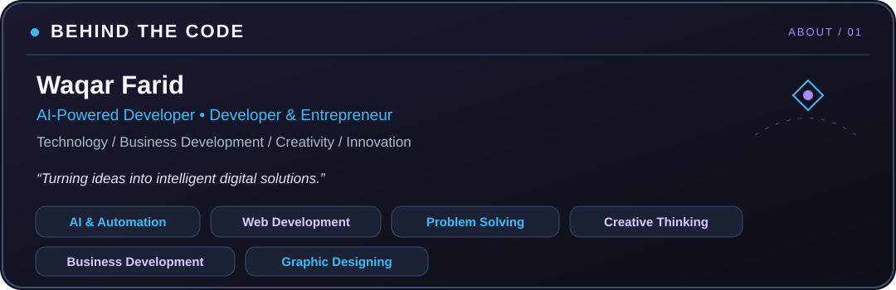
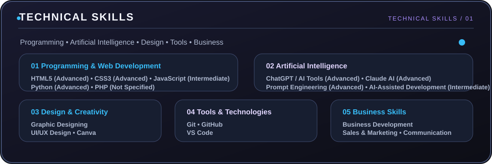
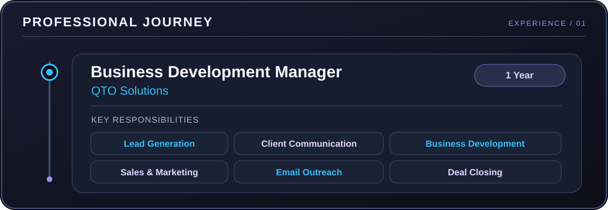
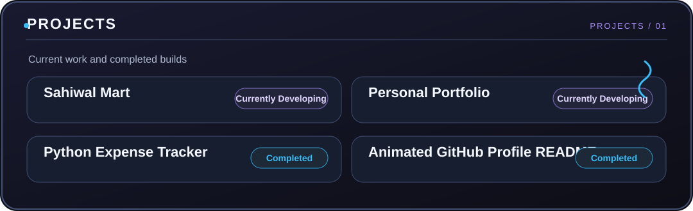
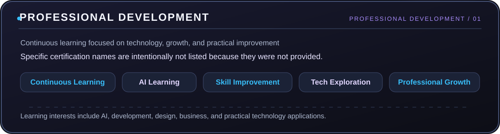
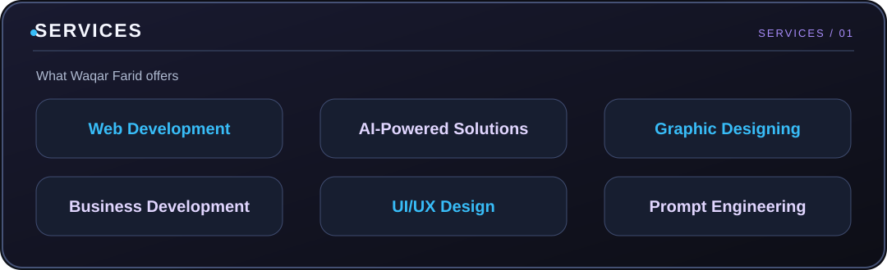
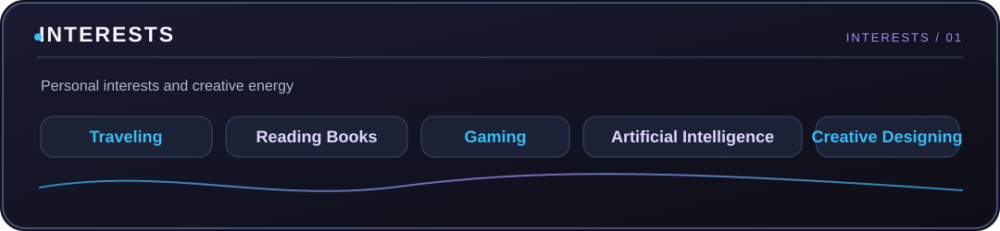
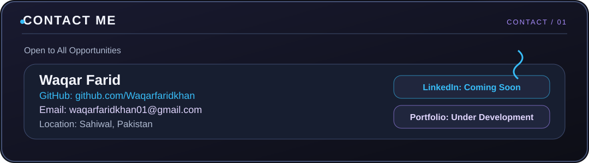

[README.md](https://github.com/user-attachments/files/35071751/README.md)

# Waqar Farid

### AI-Powered Developer · Developer & Entrepreneur

*Turning ideas into intelligent digital solutions.*

 

 

---

## ✦ About Me

I'm **Waqar Farid**, an **AI-Powered Developer** and **Developer & Entrepreneur** based in **Sahiwal, Pakistan**. My interests connect **technology, business development, creativity, and innovation**. I enjoy exploring AI and automation, web development, problem solving, creative thinking, business development, and graphic designing.

> Turning ideas into intelligent digital solutions.

---

<b>01 / Programming & Web Development</b>

| Skill | Proficiency |
| :-- | :-- |
|  | **Advanced** |
|  | **Advanced** |
|  | **Intermediate** |
|  | **Advanced** |
|  | *Not specified* |

<b>02 / Artificial Intelligence</b>

| Skill | Proficiency |
| :-- | :-- |
| ChatGPT / AI Tools | **Advanced** |
| Claude AI | **Advanced** |
| Prompt Engineering | **Advanced** |
| AI-Assisted Development | **Intermediate** |

<b>03 / Design & Creativity</b>

| Skill | Proficiency |
| :-- | :-- |
| Graphic Designing | **Advanced** |
| UI/UX Design | **Advanced** |
| Canva | **Advanced** |

<b>04 / Tools & Technologies</b>

| Skill | Proficiency |
| :-- | :-- |
|  | **Advanced** |
|  | **Advanced** |
|  | **Advanced** |

<b>05 / Business & Professional Skills</b>

| Skill | Proficiency |
| :-- | :-- |
| Business Development | **Advanced** |
| Sales & Marketing | **Advanced** |
| Communication | **Advanced** |

---

---

---

---

Committed to continuous learning, exploring technology, developing professional capabilities, and improving practical skills. My learning interests include AI, development, design, and business. Specific certification credentials are not listed because their details have not been provided.

---

---

## 📊 GitHub Statistics Dashboard

<!-- Third-party providers generate live values. No statistics are hard-coded. -->

 

### Contribution Graph

### Contribution Activity Calendar

### GitHub Trophies

### Profile Visitors

> **Live dashboard note:** These cards are provided by external services, not GitHub itself. If an image fails, follow its corresponding GitHub profile link or the recovery advice in `EDITING_GUIDE.md`. Stats and activity are dynamically fetched and are not guaranteed to load at all times. A third-party profile visitor counter may measure requests rather than unique people.

---

## ♡ Personal Interests

    

---

## ✉️ Contact Me

**Open to All Opportunities**

📍 **Sahiwal, Pakistan**

**LinkedIn:** Coming Soon · **Portfolio:** Under Development

---

